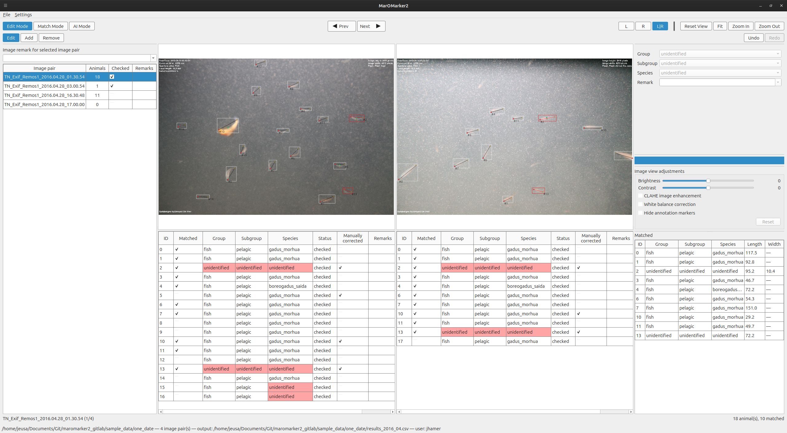

# MarOMarker2 – Quick Start

Annotate animals (head/tail, optional width) in stereo image pairs, match them between the left (L) and right (R) image, and obtain length/height measurements.

## Get the application

Download the latest build from the [GitHub releases page](https://github.com/jeusa/maromarker2/releases). Each release contains binaries for Windows and Ubuntu (Linux), built by the project's GitHub workflows.

- **Windows:** download the Windows archive, extract it and run `maromarker2.exe`.
- **Ubuntu/Linux:** download `MarOMarker2-x86_64.AppImage`, make it executable (`chmod +x MarOMarker2-x86_64.AppImage`) and run it.

To run from source instead, see the [README](README.md).

## 1. Start a session

Launch the app (the downloaded binary, or `python -m maromarker2.main` when running from source). In the setup dialog fill in (`*` = required):

| Field | Meaning |
|---|---|
| Image directory* | Folder with the L/R image pairs |
| Filename prefix filter | Only use files starting with this prefix |
| Output CSV path | Annotation file; leave empty to auto-name from the image dates. An existing CSV is loaded and continued. |
| Camera config* | Stereo calibration `.json` (needed for length/height and Auto Match) |
| Hierarchy* | Group/subgroup/species `.yaml` |
| AI model | Optional `.onnx` file (needs `inference_args.yaml` next to it) |
| User ID* / Experiment ID | Stored with every edited row |

Start another session via **File > New Session…**.

## 2. Window layout

- **Left:** image pair list (click to open) with animal count, a *Checked* box and an image remark.
- **Centre:** left and right image with the animal lists (ID, class, status, remarks) below.
- **Right:** class and remark of the selected animal, message box, image adjustments, list of matched animals.
- **Top bars:** mode switch (Edit / Match / AI), previous/next pair, view controls (L, R, L|R, Reset View, Fit, Zoom In/Out); below it the tools of the current mode and Undo/Redo.

## 3. Edit mode

| Tool | Key | Action |
|---|---|---|
| Edit | `E` | Click to select an animal, drag a keypoint to move it |
| Add | `A` | Click head, then tail. For an animal that has no width yet, the next two clicks near it set the width keypoints |
| Remove | `R` | Click an animal to delete it (click a width keypoint to delete only the width) |

Set group/subgroup/species and a remark for the selected animal in the right panel. Animals can also be selected in the lists (`Ctrl`+click toggles, `Shift`+click selects a range, `Ctrl+A` selects all). Apply bulk edits for all selected animals at the same time.

## 4. Match mode (`M`)

Pair each animal in the left image with its counterpart in the right image:

- **Manual:** select an animal on one side, then the corresponding one on the other side. Both must have compatible classes.
- **Auto Match:** proposes matches from the calibration; review and accept them in the dialog.
- **Split Match** (`S`): splits the selected matched animal(s) back into left-only and right-only animals.

Length and height are computed automatically for matched animals (height needs width keypoints on both sides).

## 5. AI mode

Requires an AI model (set at start or under **Settings > AI model…**).

- **Detect for selected:** predict for the current pair. **Detect for all:** predict for every pair.
- Predictions overlapping existing animals are discarded; new ones are `unchecked`.
- Progress is shown in the status bar (Cancel available). Editing is locked meanwhile, navigation and zooming still work.
- Moving a keypoint or changing the class of an animal marks it `checked` and manually corrected.

## 6. Navigation and view

| Action | Control |
|---|---|
| Previous / next pair | `Page Up` / `Page Down` |
| Zoom | Mouse wheel or Zoom In/Out; Fit resets to the window |
| Pan | Hold middle or right mouse button and drag |
| Deselect / cancel half-placed points | `Esc` |
| Delete selected animal(s) | `Del` |
| Undo / Redo | `Ctrl+Z` / `Ctrl+Y` |
| Save | `Ctrl+S` |

Both images are zoomed and panned together. Leaving a pair marks its animals as `checked`; the *Checked* box in the image list can also be toggled manually. The image adjustments panel offers brightness, contrast, CLAHE, white balance and *Hide annotation markers* (editing is disabled while markers are hidden).

## 7. Settings

- **Remark options…:** presets offered for object and image remarks.
- **Edit hierarchy…:** edit and save the group/subgroup/species hierarchy.
- **AI model…:** choose the `.onnx` model.
- **Appearance…:** marker size, colours, shapes, line/bounding box display.
- **Toggle Light/Dark Theme.**

## Tips

- Save regularly (`Ctrl+S`); the output CSV is only written on save.
- If an image size differs from the camera config, an error is shown when the pair is opened and existing matches are not recalculated. Measurements for new matches and edits are still computed but may be wrong, so use a matching camera config.
