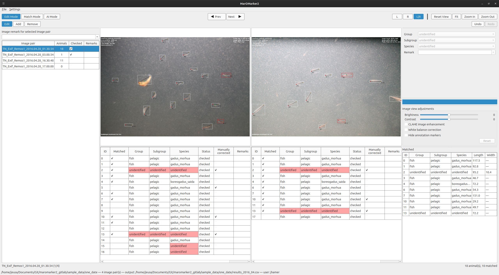
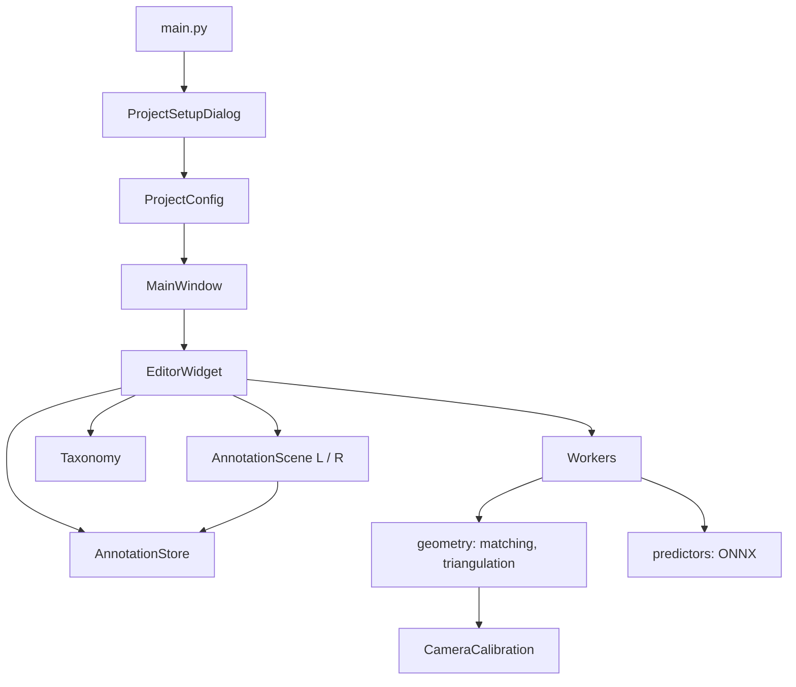

# MarOMarker 2

Desktop application for annotating animals in stereo image pairs. It records head/tail (and optional width) keypoints in the left and right image, matches the animals between both views, and derives real-world length and height from a stereo camera calibration. Annotations can be proposed by a keypoint-detection model (ONNX YOLO-pose) and are then reviewed and corrected by hand.

It is a rewrite of the legacy [fish_detection/MarOMarker](https://github.com/y-jenniges/fish_detection) for Python 3.12, PySide6 and OpenCV; the output CSV keeps the legacy column layout, so files remain interchangeable.



For a usage walkthrough see [INSTRUCTIONS.md](INSTRUCTIONS.md).

## Features

- **Stereo image sets:** scans a folder for `{prefix}_{yyyy.MM.dd}_{HH.MM.ss}_{L|R}.{jpg,jpeg,png}` files, pairs left/right images and sorts them chronologically.
- **Keypoint annotation:** add, move and remove head/tail and width points on synchronised, zoomable left/right views; undo/redo for every edit.
- **Taxonomy:** group / subgroup / species hierarchy loaded from YAML, with a built-in hierarchy editor. Unknown levels are `unidentified`.
- **Matching:** manual L/R matching, or automatic matching (Hungarian algorithm over epipolar, geometric, length and orientation costs) with a review dialog.
- **Measurement:** length (head–tail) and height (width points) by stereo triangulation, recalculated automatically for matched animals.
- **AI mode:** background keypoint detection for the current pair or all pairs with an exported U-Yolo Pose ONNX model, with progress and cancel.
- **Review workflow:** per-animal status (`checked` / `unchecked`), manual-correction flag, object and image remarks with configurable presets, per-pair checked state.
- **Image aids:** brightness, contrast, CLAHE, white balance, hide markers; configurable marker appearance; light/dark theme.
- **Persistence:** CSV output (continues an existing file), remembered setup values and settings via `QSettings`, rotating log in `~/.maromarker2/maromarker2.log`.

## Installation and running

Requires Python 3.12.

```bash
pip install -r requirements.txt
python -m maromarker2.main
```

Prebuilt AppImage (Linux) and Windows builds are produced by the GitHub workflows in `.github/workflows/` and uploaded as artifacts.

### Tests

```bash
QT_QPA_PLATFORM=offscreen pytest
```

### Building

```bash
pip install -r build_requirements.txt
bash scripts/build_appimage.sh   # Linux: Nuitka standalone build -> dist/MarOMarker2-x86_64.AppImage
```

The Windows build runs the same Nuitka command in `.github/workflows/windows.yml`.

## Input and output

| File | Description |
|---|---|
| Image directory | L/R image pairs, optionally filtered by filename prefix |
| Camera config (`.json`) | Keys `mtx_L`, `dist_L`, `mtx_R`, `dist_R`, `R`, `T`, `image_size` (see `maromarker2/configs/config_remos*.json`) |
| Hierarchy (`.yaml`) | Nested `rank` / `children` tree of groups, subgroups and species (see `maromarker2/configs/hierarchy_full.yaml`) |
| AI model (`.onnx`, optional) | Needs the `inference_args.yaml` written at export time next to it |
| Output CSV | One row per animal: `file_id`, classes, `LX1..RY4` keypoints (coordinates ≤ 0 mean "no point"), `length`, `height`, remarks, `status`, `manually_corrected`, `experiment_id`, `user_id` |

An animal seen in only one image is a left-only or right-only row; matching merges the two into one row with both sides filled.

## Repository structure

```
app_entry.py              Entry point used by the Nuitka builds
maromarker2/              Application package
  main.py                 QApplication bootstrap: logging, theme, setup dialog, main window
  models/                 Data layer (no GUI code)
  geometry/               Stereo math
  predictors/             Keypoint prediction interface and ONNX implementation
  workers/                QObject workers and standalone inference code
  ui/                     PySide6 user interface
  configs/                Example camera calibrations and hierarchy
  resources/              Application icon
tests/                    pytest suite (data layer, geometry, workers, UI widgets)
packaging/                AppImage files (AppRun, .desktop, icon)
scripts/build_appimage.sh AppImage build script
.github/workflows/        CI builds for AppImage and Windows
resources/app_ui.png      Screenshot used in the docs
INSTRUCTIONS.md           User quick start
requirements.txt          Runtime and test dependencies
build_requirements.txt    Packaging dependencies (Nuitka)
```

## Implementation structure

The code is layered: `models` and `geometry` know nothing about Qt widgets, `workers` wrap them in `QObject`s, and `ui` ties everything together.



### `maromarker2/models/` – data layer

| Module | Responsibility |
|---|---|
| `annotation_store.py` | pandas-backed store with the legacy CSV schema: load/save, add/update/remove rows, merge/split matches, image remarks, checked state |
| `image_set.py` | Folder scanning, L/R pairing into `ImagePair`, filename date/time parsing, output filename suggestion |
| `camera_calibration.py` | Loads the calibration JSON, stereo rectification, image-size validation |
| `taxonomy.py` | Group/subgroup/species tree: YAML load/save, queries, editing operations, class merging for matches |
| `project_config.py` | `ProjectConfig` dataclass holding the setup dialog values |

### `maromarker2/geometry/`

- `triangulation.py`: converts left/right pixel points to 3D and returns distances for length and height.
- `matching.py`: cost matrix over rectified epipolar distance, raw head distance, length difference and orientation difference; `scipy` Hungarian assignment; rejects pairs above a cost threshold or with incompatible classes.

### `maromarker2/predictors/` and `maromarker2/workers/`

- `predictors/__init__.py` defines `KeypointPredictor` and `PredictedAnimal`; `onnx_predictor.py` implements it on top of `workers/inference_standalone.py` (self-contained ONNX YOLO-pose inference with hierarchy descent and NMS), including model validation.
- `prediction_worker.py` runs a predictor over image pairs on a `QThread` and emits progress and results; the editor applies them to the store on the main thread.
- `matching_worker.py` and `triangulation_worker.py` wrap the geometry code in the same QObject + `run()` pattern.

### `maromarker2/ui/` – user interface

| Module | Responsibility |
|---|---|
| `main_window.py` | Menus (File, Settings), status bar, prediction progress, loads the session data and installs the editor |
| `project_setup_dialog.py` | Session setup form with validation against the real data layer |
| `app_settings.py` | `QSettings`-backed remembered values, theme and remark presets |
| `theme.py` | Light/dark palette and stylesheet |
| `remark_options_dialog.py` | Editor for the remark presets |
| `hierarchy_editor/` | Dialog and tree widget for editing and saving the taxonomy |
| `editor/` | The annotation workspace (below) |

`ui/editor/` in detail:

| Module | Responsibility |
|---|---|
| `editor_widget.py` | Central controller: modes (Edit / Match / AI), tools, toolbars, splitter layout, pair navigation, selection sync, undo stack, matching, prediction thread |
| `annotation_scene.py` | `QGraphicsScene` per side: draws and edits markers, lines, labels and boxes directly on the store |
| `image_canvas.py` | `QGraphicsView` with wheel zoom and pan; the two canvases are linked |
| `image_list_panel.py` | Pair list with animal count, checked box and image remark |
| `animal_list_panel.py` / `matched_list_panel.py` | Per-side animal tables and the table of matched animals |
| `side_panel.py` / `remark_edit.py` | Class and remark editor for the selected animal(s) |
| `image_adjustments.py` | Brightness/contrast/CLAHE/white-balance panel and processing |
| `match_review_dialog.py` | Review of automatic match proposals |
| `editor_settings.py` / `editor_settings_dialog.py` | Marker appearance settings and dialog |
| `color_hints.py`, `info_panel.py` | Colouring by class or match state; transient message box |

### Data flow

1. `main.py` shows the setup dialog; the result is a `ProjectConfig`.
2. `MainWindow.load_project` loads the calibration, taxonomy, image pairs and the annotation store (existing CSV or new), then builds the `EditorWidget`.
3. User actions in the scenes and panels modify the `AnnotationStore`; the editor wraps changes in snapshot-based undo commands and refreshes both scenes and all lists.
4. Matching and edits of matched animals recompute length/height through the triangulation worker.
5. AI detection runs in a worker thread; results are merged into the store on the main thread. Editing is locked until it finishes or is cancelled.
6. **File > Save** writes the store to the output CSV.

## License

See [LICENSE](LICENSE).

